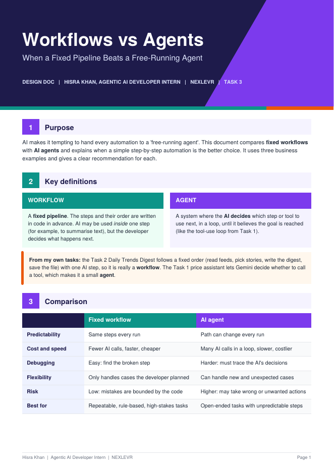

# 📘 Workflows vs Agents: When a Fixed Pipeline Beats a Free-Running Agent

A short design doc comparing **fixed workflows** and **AI agents**, and explaining when a simple step-by-step automation should beat a free-running agent. It includes **3 business examples**, each with a clear recommendation.

> Written for **Task 3** of the **Agentic AI Developer Internship at NEXLEVR**.

## 📄 Read the document

**[Workflows-vs-Agents-Design-Doc.pdf](Workflows-vs-Agents-Design-Doc.pdf)** (3 pages)

## 🧠 The two ideas in one line each

- **Workflow:** a fixed pipeline. The steps and their order are written in code in advance. AI may be used inside one step.
- **Agent:** the AI decides which step or tool to use next, in a loop, until it thinks the goal is reached.

## ⚖️ Quick comparison

| | Fixed workflow | AI agent |
|---|---|---|
| Predictability | Same steps every run | Path can change every run |
| Cost and speed | Cheaper, faster | Costlier, slower |
| Debugging | Easy | Harder |
| Flexibility | Only planned cases | Handles unexpected cases |
| Risk | Low | Higher |

## 💼 Three business examples

| # | Example | Recommendation |
|---|---|---|
| 1 | Order processing in an online store | **Fixed workflow**: same steps every time, involves money, must be auditable |
| 2 | Daily social media trends digest for a brand | **Workflow with one AI step**: fixed schedule, sources and format |
| 3 | Customer support for an e-commerce or telecom company | **Bounded agent (hybrid)**: flexible, but sensitive actions need human approval |

## ✅ Final recommendation

1. Start with the simplest design that works: a workflow.
2. Add AI inside individual steps before turning the whole system into an agent.
3. Use an agent only where the path is truly unpredictable, and limit it with few tools, spending limits, logging and human approval.
4. Many good real-world systems are hybrids.

## 🔗 Related tasks

- **Task 1:** a small tool-using AI (an agent) built with Gemini function calling.
- **Task 2:** a daily trends digest (a workflow with one AI step) that reads 5 RSS feeds.

## 👤 Author

**Hisra Khan** | Agentic AI Developer Intern at NEXLEVR